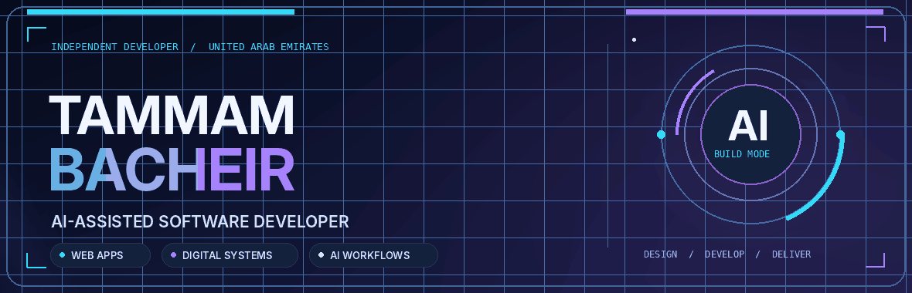
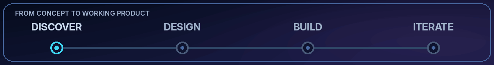

<!-- Tammam Bacheir | GitHub profile | Dark Tech / Motion Edition
     Requirements: keep README.md, hero-animated.gif, product-process.gif in the SAME repository folder.
     Animations: 2 local GIF files + an optional third-party typing SVG.
     No scripts, iframes, external CSS, or fabricated metrics. -->

  
   
  
   
  
  
  
    
  
  
  

---

###   Building software that solves real problems

I’m **Tammam Bacheir**, **Founder & Director of VALO2 Agency** and an independent software developer working on websites, desktop applications, business systems, and AI-assisted digital solutions. I take projects from early concept through design and implementation, with a focus on practical outcomes and continuous improvement.

<table>
  <tr>
    <td width="50%" valign="top">
      <h3>◈ What I Build</h3>
      
Web applications, digital platforms, practical business systems, and mobile-oriented product experiences.

      
<strong>Approach:</strong> Understand the goal → design the experience → build → improve.

    </td>
    <td width="50%" valign="top">
      <h3>◈ What I'm Exploring</h3>
      
AI integration, system architecture, scalable patterns, software quality, and meaningful collaboration.

      
<strong>Mindset:</strong> Use modern tools thoughtfully while strengthening core engineering skills.

    </td>
  </tr>
</table>

###   Selected products & projects

#### ✦ VALO2 Agency — Founder & Director

**Digital services agency and official website**

I founded and manage **VALO2 Agency**, combining digital services, software development, and AI-assisted workflows to create practical solutions for businesses.

🌐 **Website:** [valo2.com](https://valo2.com)

#### ✦ Al Farabi Medical Centre — Website

**Medical centre web presence**

A website project for **Al Farabi Medical Centre**, supporting the centre’s digital presence and presentation of its services.

🌐 **Website:** [alfarabimc.com](https://alfarabimc.com)

#### ✦ VALO2 Internal Software — Three Systems + Windows Application

**Internal business software**

Three agency-specific software systems, alongside a **Windows desktop application**, developed to support VALO2's internal workflows. Product-specific names and public demonstrations can be added separately.

#### ✦ Proprietary Membership Management System

**Commercial software product · Independently developed and owned**

A proprietary membership management solution developed by **Tammam Bacheir**, designed for business membership programs and flexible commercial use. Potential business models include **annual subscriptions**, **licensing agreements**, **custom contracts**, or a **negotiated software sale**.

Intellectual-property registration in the UAE is **planned but has not yet been applied for**.

  
Commercial opportunities

  
Commercial models and terms are subject to discussion and agreement based on business needs and scope.

#### ◈ E-commerce Store — In Development

An e-commerce project currently under development. Its public showcase and technical details will be added when ready.

###   Technologies used in reviewed projects

  
<strong>LANGUAGES & WEB FOUNDATIONS</strong>

  
  
  
  
  
<strong>FRONTEND & APPLICATION DEVELOPMENT</strong>

  
  
  
  
  
  
  
<strong>BACKEND & DATA</strong>

  
  
  
<strong>DEVELOPMENT & DELIVERY</strong>

  
  
  
  

###   Product workflow

  
<strong>Explore the workflow</strong>

  
<strong>Discover:</strong> Clarify the business goal, users, and functional scope.

  
<strong>Design:</strong> Shape the architecture, interface, and user journeys.

  
<strong>Build:</strong> Implement working functionality with AI-assisted development and code review.

  
<strong>Iterate:</strong> Validate outcomes and improve quality incrementally.

###   Let's build something useful

  <h3>Have a project or collaboration in mind?</h3>
  
For business inquiries, software solutions, agency collaborations, or membership system licensing, get in touch.

  
  
  
    
  <strong>Tammam Bacheir</strong> · Engineering ideas into practical digital products.

